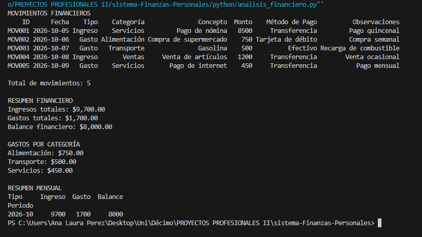
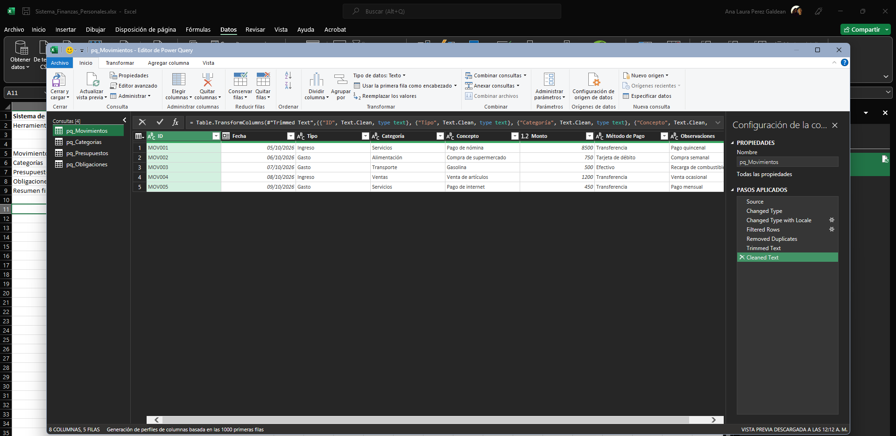
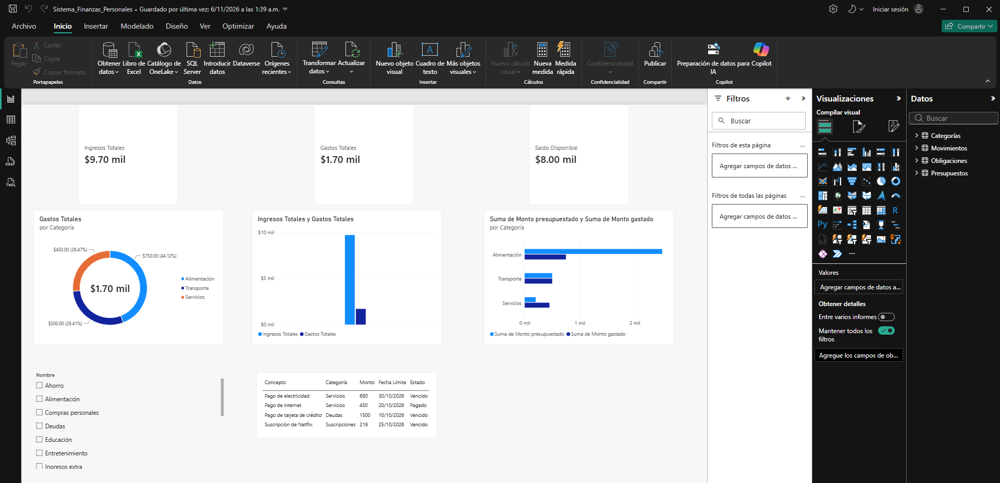

# Integración de los componentes del Sistema de Finanzas Personales

## Objetivo

Verificar la integración y consistencia de los componentes desarrollados para el prototipo del Sistema de Finanzas Personales, utilizando Excel, Power Query, Power BI y Python con Pandas.

La integración tiene como propósito comprobar que los datos financieros puedan ser consultados y procesados por las diferentes herramientas, manteniendo resultados consistentes en los cálculos y visualizaciones.

## Componentes integrados

### Microsoft Excel

Excel funciona como la fuente principal de información del prototipo.

El archivo `excel/Sistema_Finanzas_Personales.xlsx` contiene las hojas Movimientos, Categorías, Presupuestos y Obligaciones, utilizadas para registrar y organizar la información financiera.

Los datos registrados en Excel sirven como base para los análisis realizados con las demás herramientas.

### Power Query

Power Query se utiliza para importar, validar y limpiar los datos financieros.

Se configuraron cuatro consultas dentro de Excel:

- `pq_Movimientos`
- `pq_Categorias`
- `pq_Presupuestos`
- `pq_Obligaciones`

Las consultas incluyen transformaciones para configurar tipos de datos, filtrar registros vacíos, eliminar duplicados y limpiar textos.

Durante la integración se comprobó que las consultas estuvieran disponibles y que la consulta de movimientos mostrara correctamente los cinco registros del prototipo.

### Power BI

Power BI permite visualizar y analizar la información financiera mediante indicadores, gráficos y tablas.

El archivo `powerbi/Sistema_Finanzas_Personales.pbix` contiene cuatro consultas correspondientes a Movimientos, Categorías, Presupuestos y Obligaciones.

Se verificó que las consultas utilizaran la ubicación correcta del archivo Excel y que el dashboard mostrara los resultados financieros esperados.

El dashboard incluye indicadores de ingresos, gastos y saldo disponible, gráficos de distribución de gastos, comparación de presupuestos y una tabla de obligaciones.

### Python y Pandas

Python y Pandas se utilizan para realizar análisis adicionales de los movimientos financieros.

El programa `python/analisis_financiero.py` importa los registros desde Excel y calcula los ingresos totales, gastos totales, balance financiero, gastos agrupados por categoría y resumen mensual.

El programa permite comprobar los resultados obtenidos mediante Power BI y facilita futuros análisis de la información.

## 3. Proceso de integración

La integración se realizó utilizando el archivo Excel como fuente común de datos.

Primero, se ejecutó el programa de Python para comprobar que pudiera importar los movimientos financieros y generar los cálculos correspondientes.

Posteriormente, se revisaron las consultas de Power Query en Excel, verificando su disponibilidad y la correcta visualización de los registros y transformaciones.

Después, se revisaron las consultas de Power BI y se corrigieron las rutas de origen que hacían referencia a otra computadora. Una vez configuradas las ubicaciones del archivo Excel, se aplicaron los cambios y se comprobó la visualización de los datos en el dashboard.

Finalmente, se compararon los indicadores financieros obtenidos con Python y Power BI para verificar su consistencia.

## 4. Verificaciones realizadas

### INT-01. Integración entre Excel y Python

**Objetivo:** Comprobar que Python pueda importar y analizar los movimientos registrados en Excel.

**Resultado esperado:** Importación de cinco movimientos y generación correcta de los indicadores financieros.

**Resultado obtenido:** Se importaron cinco movimientos y se calcularon ingresos de $9,700.00, gastos de $1,700.00 y un balance de $8,000.00.

**Estado:** Aprobado.

### INT-02. Integración entre Excel y Power Query

**Objetivo:** Verificar la disponibilidad de las consultas y la lectura de los movimientos financieros.

**Resultado esperado:** Cuatro consultas disponibles y visualización correcta de los cinco movimientos.

**Resultado obtenido:** Se identificaron las cuatro consultas configuradas como conexiones y se visualizaron los cinco movimientos en el Editor de Power Query, con sus pasos de transformación.

**Estado:** Aprobado para la consulta de movimientos. Las demás consultas se identificaron como disponibles.

### INT-03. Integración entre Excel y Power BI

**Objetivo:** Comprobar que Power BI pueda acceder al archivo Excel y mostrar los indicadores financieros esperados.

**Resultado esperado:** Consultas con rutas válidas y visualización consistente de los datos financieros.

**Resultado obtenido:** Se corrigieron las rutas de origen y se visualizaron los indicadores y gráficos del dashboard con los valores esperados.

**Estado:** Aprobado.

## 5. Resultados de la integración

Los resultados financieros obtenidos durante las verificaciones fueron los siguientes:

| Indicador               |       Resultado |
| ----------------------- | --------------: |
| Movimientos registrados |               5 |
| Ingresos totales        |       $9,700.00 |
| Gastos totales          |       $1,700.00 |
| Balance financiero      |       $8,000.00 |
| Gastos de Alimentación |         $750.00 |
| Gastos de Transporte    |         $500.00 |
| Gastos de Servicios     |         $450.00 |
| Periodo analizado       | Octubre de 2026 |

Los valores obtenidos mediante Python coincidieron con los indicadores visualizados en Power BI.

## 6. Evidencias de integración

### Integración entre Excel y Python

**Figura 1.** Ejecución del análisis financiero con Python y Pandas utilizando los datos de Excel.

### Integración entre Excel y Power Query

**Figura 2.** Visualización de los movimientos financieros y los pasos de transformación en Power Query.

### Integración entre Excel y Power BI

**Figura 3.** Dashboard financiero con los indicadores, gráficos y obligaciones del prototipo.

## Observaciones

Durante la integración se identificó que algunas consultas de Power BI conservaban rutas de acceso correspondientes a otra computadora.

Para solucionar el problema, se actualizaron las ubicaciones del archivo Excel en las consultas afectadas, conservando los pasos de transformación y los elementos del dashboard.

Debido a que el proyecto se desarrolla en diferentes computadoras, las rutas locales del archivo Excel pueden requerir ajustes cuando se utilice Power BI en otro equipo.

La integración realizada comprueba la compatibilidad de los componentes con los datos de prueba actuales, pero no representa una validación completa del sistema terminado.

## Conclusión

La integración de los componentes del Sistema de Finanzas Personales permitió comprobar que Excel puede utilizarse como fuente de información para los análisis desarrollados con Python y Power BI.

Las verificaciones realizadas mostraron resultados consistentes en los cálculos de ingresos, gastos, balance financiero y distribución de gastos por categoría.

También se comprobó el funcionamiento de las consultas de Power Query y se corrigieron las rutas de acceso necesarias para utilizar el proyecto desde diferentes computadoras.

Con estos resultados, el prototipo cuenta con componentes de captura, preparación, análisis y visualización de datos que pueden utilizarse como base para continuar con las pruebas funcionales y la documentación final del sistema.
