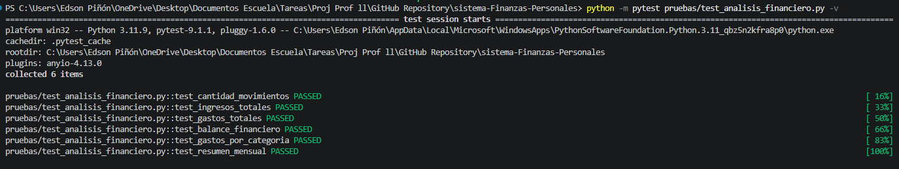

# Pruebas del análisis financiero con Python y Pandas

## 1. Objetivo

Verificar el funcionamiento de los análisis financieros desarrollados con Python y Pandas mediante pruebas automatizadas con pytest. Las pruebas permiten comprobar la importación de movimientos desde Excel y la exactitud de los cálculos de ingresos, gastos, balance financiero, gastos por categoría y resumen mensual.

## 2. Entorno de pruebas

- Proyecto: Sistema de Finanzas Personales.
- Responsable: Edson.
- Lenguaje: Python 3.11.9.
- Bibliotecas: Pandas 3.0.2 y OpenPyXL 3.1.5.
- Herramienta de pruebas: pytest 9.1.1.
- Entorno de desarrollo: Visual Studio Code.
- Archivo analizado: `excel/Sistema_Finanzas_Personales.xlsx`.
- Script de análisis: `python/analisis_financiero.py`.
- Archivo de pruebas: `pruebas/test_analisis_financiero.py`.

## 3. Casos de prueba

### PY-01. Importación de movimientos

**Objetivo:** Verificar que se importen correctamente los movimientos financieros registrados en Excel.

**Resultado esperado:** Se identifican cinco movimientos válidos.

**Resultado obtenido:** Se importaron cinco movimientos.

**Estado:** Aprobado.

### PY-02. Cálculo de ingresos totales

**Objetivo:** Comprobar que Pandas calcule correctamente la suma de los ingresos.

**Resultado esperado:** $9,700.00.

**Resultado obtenido:** $9,700.00.

**Estado:** Aprobado.

### PY-03. Cálculo de gastos totales

**Objetivo:** Comprobar que Pandas calcule correctamente la suma de los gastos.

**Resultado esperado:** $1,700.00.

**Resultado obtenido:** $1,700.00.

**Estado:** Aprobado.

### PY-04. Cálculo del balance financiero

**Objetivo:** Verificar que el balance corresponda a la diferencia entre ingresos y gastos.

**Resultado esperado:** $8,000.00.

**Resultado obtenido:** $8,000.00.

**Estado:** Aprobado.

### PY-05. Gastos por categoría

**Objetivo:** Verificar la agrupación de los gastos mediante Pandas.

**Resultados esperados:**
- Alimentación: $750.00.
- Transporte: $500.00.
- Servicios: $450.00.

**Resultados obtenidos:** Los tres valores coincidieron con los esperados.

**Estado:** Aprobado.

### PY-06. Resumen mensual

**Objetivo:** Comprobar la agrupación mensual de ingresos y gastos.

**Periodo evaluado:** Octubre de 2026.

**Resultados esperados:**
- Ingresos: $9,700.00.
- Gastos: $1,700.00.
- Balance: $8,000.00.

**Resultados obtenidos:** Los valores coincidieron con los esperados.

**Estado:** Aprobado.

## 4. Ejecución de las pruebas

Las pruebas se ejecutaron desde la terminal de Visual Studio Code mediante el comando:

```powershell
python -m pytest pruebas/test_analisis_financiero.py -v
```

Se ejecutaron seis casos de prueba y todos finalizaron correctamente.

**Resultado general:** 6 pruebas aprobadas, 0 fallidas.

## 5. Evidencia

La captura de la ejecución se encuentra en:



**Figura 1.** Ejecución de las seis pruebas automatizadas del análisis financiero con Python y pytest.

## 6. Conclusión

Las pruebas realizadas permitieron comprobar que los análisis financieros desarrollados con Python y Pandas generan los resultados esperados a partir de los cinco movimientos de ejemplo registrados en Excel.

Los cálculos de ingresos, gastos, balance financiero, gastos por categoría y resumen mensual coincidieron con los valores previamente verificados en Power BI.

Estos resultados validan los análisis implementados con los datos de prueba utilizados, pero no representan una validación completa del sistema terminado.
